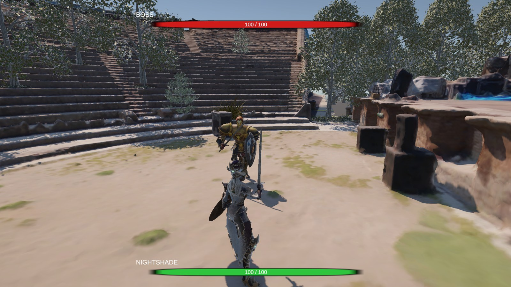
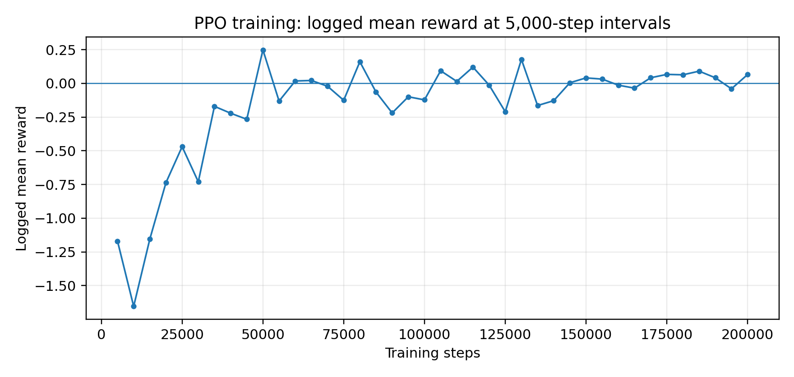
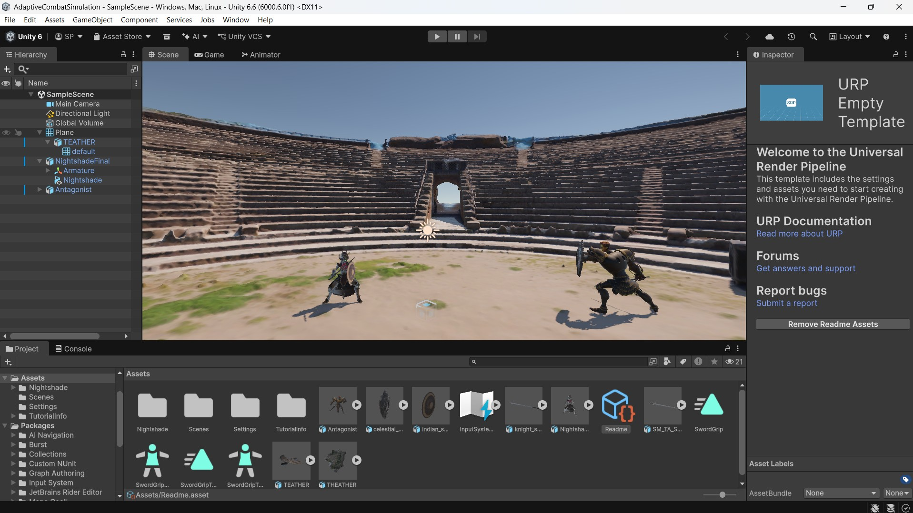
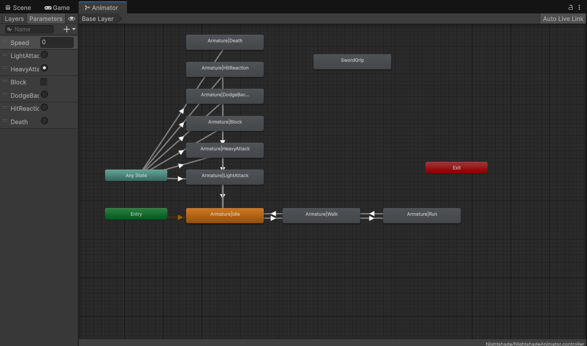

# Adaptive Combat Simulation

A 3D sword-combat game built in **Unity 6** where an antagonist controlled by a **PPO-trained reinforcement learning policy** (Unity ML-Agents) fights a playable character, **Nightshade**. The trained policy is exported to **ONNX** and runs inside the game.

Built at **Bennett University** (School of Computer Science Engineering and Technology) under the supervision of Mr. Anirudh Manoj.



## Features
- Playable 3D arena combat with health bars for both fighters
- RL-controlled antagonist (PPO via Unity ML-Agents) running from an ONNX model
- Combat actions: light attack, heavy attack, block, dodge, hit reaction, death
- Animator-driven character states (locomotion + combat)
- Sword-collider hit detection
- Event-driven reward system (`CombatRewardController`) with dense shaping rewards
- Windows build available on the Releases page

## Download and play
1. Go to the [**Releases**](../../releases) page.
2. Download `AdaptiveCombatSimulation_Windows.zip`.
3. Extract the zip and run `AdaptiveCombatSimulation.exe`.

No Unity installation needed.

## Run from source
**Requirements:** Unity 6 (editor version `6000.6.0f1`, check `ProjectSettings/ProjectVersion.txt`), [Git LFS](https://git-lfs.com/).

```bash
git lfs install
git clone https://github.com/pratyushwinorlearn/Adaptive-Combat-Simulation.git
```

1. Open the cloned folder in Unity Hub.
2. Open `Assets/Scenes/SampleScene`.
3. Press Play. The antagonist uses `Models/AdaptiveCombat.onnx`.

## Training
Training uses the Unity ML-Agents Python package.

```bash
pip install mlagents
mlagents-learn <path-to-config>.yaml --run-id=adaptive_combat_run
```

Then press Play in the Unity editor when prompted. Copy the exported `.onnx` into `Models/` and assign it to the agent's Behavior Parameters.

**PPO settings used**

| Parameter | Value |
|---|---|
| Batch size | 256 |
| Buffer size | 4096 |
| Learning rate | 3e-4 |
| Beta | 0.005 |
| Epsilon | 0.2 |
| Epochs | 3 |
| Gamma | 0.99 |
| Time horizon | 64 |
| Hidden units / layers | 128 / 2 |
| Max steps | 200,000 |

## Reward design
| Event | Reward |
|---|---|
| Damage dealt | +0.01 × amount |
| Damage taken | -0.01 × amount |
| Successful block | +0.10 |
| Successful dodge | +0.15 |
| Being blocked | -0.10 |
| Being dodged | -0.10 |
| Win / Loss | +1.0 / -1.0 |

Dense shaping (facing opponent +0.002, facing away -0.003, distance improvement +0.02, desired distance 2.5) was also used during development. These were not necessarily all active in the final run.

## Results
- Training completed 200,000 steps (`adaptive_combat_real_v2_20261023`) and the final model was exported to ONNX.
- The antagonist consistently beat Nightshade in observed tests, but relied mostly on light and heavy attacks. Block and dodge were underused because Nightshade could be beaten without defending.
- Future work: stronger opponent behaviour, better reward shaping, and repeated-trial evaluation (win rate, action frequencies, damage, episode length).



## Screenshots
| Scene | Animator |
|---|---|
|  |  |

## Project structure
```
Assets/           Unity scenes, scripts, characters, animations
Models/           Trained ONNX policy (AdaptiveCombat.onnx)
Packages/         Unity package manifest
ProjectSettings/  Unity project settings
docs/             IEEE report and images
```

## Report
Full IEEE-format report: [docs/AdaptiveCombatSimulation_IEEE_Report.pdf](docs/AdaptiveCombatSimulation_IEEE_Report.pdf)

## Authors
Shekhar Pratyush, Pranjal Raj, Aditya Raj, Yash Raj Pandey

## License
Add a license (for example MIT) if you want others to reuse the code.
